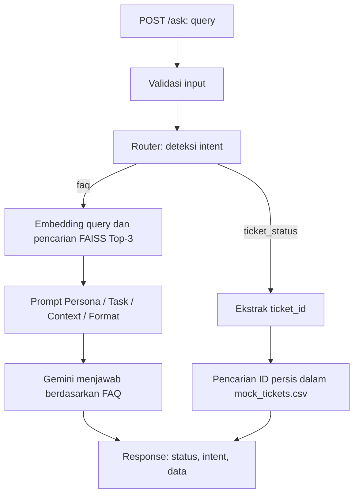

# IT Helpdesk Assistant

Individual Assignment 4 - End-to-End RAG & AI Agent Development.

## 1. Problem statement dan tujuan

Tim People & IT Operations menerima pertanyaan kebijakan yang berulang serta permintaan pengecekan status tiket. Tujuan aplikasi ini adalah menyediakan satu endpoint yang dapat memilih cara menjawab sesuai kebutuhan pengguna.

| Jenis permintaan | Contoh | Cara penanganan |
|---|---|---|
| Informasi/kebijakan (`faq`) | "Berapa jatah cuti tahunan karyawan tetap?" | Cari FAQ relevan menggunakan embedding dan FAISS, lalu susun jawaban dengan Gemini. |
| Status tiket (`ticket_status`) | "Apa status TICKET-0002 saya?" | Cocokkan `ticket_id` secara persis dengan CSV mock tiket dan tampilkan datanya. |

Data menggunakan seluruh aset starter: 31 FAQ pada `data/it_helpdesk_knowledge_base.csv` dan 15 tiket pada `data/mock_tickets.csv`. Kedua CSV asli tidak diubah.

## 2. Desain workflow



Aturan router menggunakan baseline keyword yang diperbolehkan brief:

1. Query yang menyebut ID `TICKET-XXXX` diarahkan ke tool tiket. Penulisan huruf kecil dan spasi di sekitar tanda `-` juga dikenali.
2. Permintaan yang menyebut tiket dan kata seperti `status`, `cek`, `perkembangan`, atau `diproses` juga diarahkan ke tool. Jika ID belum diberikan atau formatnya salah, sistem meminta ID yang benar.
3. Pertanyaan prosedur umum, misalnya "Bagaimana cara mengajukan tiket IT?", diarahkan ke FAQ.
4. Pertanyaan lainnya diarahkan ke RAG. Jika knowledge base tidak menjawabnya, LLM diminta mengakui keterbatasan informasi atau meminta klarifikasi. Karena itu, pertanyaan di luar cakupan dapat ber-intent `faq` tetapi dijawab dengan penolakan yang sesuai.
5. Satu request hanya memproses satu ID tiket. Jika ada dua ID berbeda, sistem meminta pengguna memilih satu.

## 3. Struktur project dan implementasi

```text
it-helpdesk-assignment/
├── app/
│   ├── __init__.py
│   ├── main.py
│   ├── rag.py
│   ├── router.py
│   └── tools.py
├── data/
│   ├── it_helpdesk_knowledge_base.csv
│   └── mock_tickets.csv
├── Dockerfile
├── .dockerignore
├── .env.example
├── .gitignore
├── requirements.txt
└── README.md
```


| File | Deskripsi |
|---|---|
| [app/main.py](app/main.py) | Validasi request, endpoint `/health` dan `/ask`, response terstruktur, serta error handling. |
| [app/router.py](app/router.py) | Deteksi intent, ekstraksi ID, dan pemilihan RAG atau tool call. |
| [app/rag.py](app/rag.py) | Membuat embedding, membangun FAISS, mencari Top-3 FAQ, menyusun prompt, dan memanggil Gemini. |
| [app/tools.py](app/tools.py) | Membaca CSV mock dan mencari status tiket tanpa LLM. |

Nama dan urutan fungsi starter dipertahankan. Implementasi RAG mengadaptasi notebook Assignment 3:

- Section 1-2: membaca CSV dan menggabungkan `question + answer` menjadi satu dokumen per FAQ.
- Section 3-4: embedding batch maksimal 20 teks, 768 dimensi, normalisasi L2, dan `faiss.IndexFlatIP`.
- Section 5: pencarian Top-K dengan metadata FAQ dan similarity score.
- Section 6-7: prompt Persona-Task-Context-Format dan jawaban berdasarkan konteks hasil retrieval.

Model embedding adalah `gemini-embedding-001`. Dokumen memakai `RETRIEVAL_DOCUMENT`, sementara pertanyaan memakai `RETRIEVAL_QUERY`. Default LLM adalah `gemini-3.5-flash-lite`, sama dengan notebook Assignment 3; dapat diubah melalui `GEMINI_LLM_MODEL`.

Index disimpan di memori proses dan dibangun secara lazy pada request FAQ pertama. Request berikutnya memakai ulang index tersebut. Lock sederhana mencegah pembangunan index ganda saat request pertama datang bersamaan. Restart aplikasi akan membangun ulang index pada request FAQ berikutnya. Panggilan API dan pekerjaan blocking dijalankan melalui `asyncio.to_thread`, mengikuti Sesi 13.4.

## 4. Konfigurasi environment

Gunakan Python 3.12. Pengujian lokal memakai interpreter yang ditentukan:

Jika belum memiliki `.env`, salin template berikut dari root project:

```powershell
Copy-Item .env.example .env
```

Isi `GEMINI_API_KEY` dengan API key milik sendiri. Jika key sudah tersedia pada environment Windows/terminal, file `.env` tidak diperlukan. Environment yang sudah aktif diprioritaskan dibanding isi `.env`. `GOOGLE_API_KEY` juga didukung sebagai alternatif jika `GEMINI_API_KEY` tidak terisi.

| Variable | Keterangan |
|---|---|
| `GEMINI_API_KEY` | API key untuk embedding dan generation. |
| `GEMINI_LLM_MODEL` | Opsional; default `gemini-3.5-flash-lite`. |

API key tidak ditulis di kode. `.gitignore` dan `.dockerignore` mengecualikan `.env`. Dockerfile hanya menyalin `app/`, `data/`, dan dependency yang diperlukan. Untuk pengumpulan, sertakan `.env.example`, bukan `.env` asli.

## 5. Menjalankan tanpa Docker

Dari PowerShell:

```powershell
python -m uvicorn app.main:app --host 127.0.0.1 --port 8000 --reload
```

Setelah muncul pesan `Application startup complete`, server sudah siap digunakan. Untuk mencoba aplikasinya:

1. **Biarkan terminal tersebut tetap berjalan.**
2. Buka [http://127.0.0.1:8000/docs](http://127.0.0.1:8000/docs) di browser.
3. Klik **POST /ask**, lalu **Try it out**.
4. Ganti isi **Request body** dengan:

   ```json
   {
     "query": "Apa status tiket TICKET-0002?"
   }
   ```

5. Klik **Execute**, lalu lihat bagian **Server response → Response body**. Hasilnya seharusnya menampilkan `status: "success"`, `intent: "ticket_status"`, dan status tiket **Diproses**.

Contoh response untuk pengecekan tiket:

```json
{
  "status": "success",
  "intent": "ticket_status",
  "data": "Tiket: TICKET-0002\nSubjek: Permintaan akses Google Analytics\nStatus: Diproses\nPembaruan terakhir: 2026-08-25"
}
```

Untuk mencoba jalur **RAG**, ganti pertanyaan pada **Request body** menjadi:

```json
{
  "query": "Berapa jatah cuti tahunan karyawan tetap?"
}
```

Lalu klik **Execute** lagi. Pertanyaan FAQ pertama membutuhkan waktu lebih lama karena aplikasi membangun **index embedding** terlebih dahulu. Jalur ini memerlukan API key Gemini yang aktif. Jika berhasil, respons berisi `intent: "faq"` dan jawaban berdasarkan knowledge base.

Untuk memeriksa apakah service berjalan, buka [http://127.0.0.1:8000/health](http://127.0.0.1:8000/health). Hasil normalnya adalah `{"status":"ok"}`; endpoint ini tidak memeriksa koneksi Gemini.

**Jika muncul `404 Not Found` saat membuka `http://127.0.0.1:8000/`:** aplikasi belum menyediakan halaman utama di alamat `/`. Gunakan alamat `/docs` untuk mencoba API atau `/health` untuk memeriksa service.

Jika selesai, tekan **Ctrl+C** di terminal untuk menghentikan server.

## 6. Menjalankan dengan Docker

Pastikan Docker Desktop aktif, lalu jalankan dari root project:

```powershell
docker build -t it-helpdesk-assignment:local .
docker run --rm --name it-helpdesk-assignment -p 127.0.0.1:8000:8000 --env-file .env it-helpdesk-assignment:local
```

Jika memakai API key dari environment terminal, gunakan perintah berikut sebagai pengganti `docker run` di atas:

```powershell
docker run --rm --name it-helpdesk-assignment -p 127.0.0.1:8000:8000 -e GEMINI_API_KEY -e GOOGLE_API_KEY -e GEMINI_LLM_MODEL it-helpdesk-assignment:local
```

Gunakan alamat `/docs`, `/health`, dan `/ask` yang sama. Hentikan server lokal lebih dulu jika port 8000 masih digunakan. Container mendengarkan pada `0.0.0.0:8000`, sedangkan port di laptop dibatasi ke localhost.

Untuk menghentikan container dari terminal lain:

```powershell
docker stop it-helpdesk-assignment
```

Deployment cloud dan Docker Compose tidak diperlukan untuk assignment ini.

## 7. Pengujian dan observasi

### Cara mengulang pengujian wajib

Jalankan aplikasi, lalu buka terminal PowerShell kedua. Lima query pertama memenuhi komposisi yang diminta brief; query keenam memeriksa batas informasi pribadi.

```powershell
$queries = @(
    'Berapa jatah cuti tahunan karyawan tetap?',
    'Saya lupa kata sandi VPN kantor. Bagaimana menggantinya?',
    'Tolong cek status tiket TICKET-0002 saya.',
    'Apa status tiket TICKET-9999?',
    'Bagaimana cara membuat nasi goreng?',
    'Berapa sisa cuti saya saat ini?'
)

foreach ($query in $queries) {
    $body = @{ query = $query } | ConvertTo-Json
    $response = Invoke-RestMethod -Method Post -Uri 'http://localhost:8000/ask' -ContentType 'application/json; charset=utf-8' -Body $body
    [PSCustomObject]@{
        query = $query
        status = $response.status
        intent = $response.intent
        data = $response.data
    } | Format-List
}
```

### Hasil aktual

**Tanggal pengujian: 26 Oktober 2026 (WIB).** Pengujian memakai Gemini asli melalui HTTP, bukan jawaban mock.

- Pengujian lokal selesai: `2026-10-26T19:57:37+07:00`.
- Pengujian Docker selesai: `2026-10-26T20:02:20+07:00`.
- Image: `it-helpdesk-assignment:local`, dibangun dari Dockerfile project ini.
- Konfigurasi: `gemini-embedding-001`, 768 dimensi, `gemini-3.5-flash-lite`, Top-K 3, temperature 0.1.
- Seluruh 6 skenario pada masing-masing lingkungan menghasilkan HTTP 200, `status=success`, dan intent sesuai target. Isi jawaban diperiksa terhadap CSV sumber.

| Uji | Query | Intent aktual | Hasil lokal / Docker | Observasi |
|---|---|---|---|---|
| Q1 | Berapa jatah cuti tahunan karyawan tetap? | `faq` | Lulus / Lulus | Jawaban menyebut 12 hari cuti setelah masa kerja minimal 3 bulan, bersumber dari FAQ 1. |
| Q2 | Saya lupa kata sandi VPN kantor. Bagaimana menggantinya? | `faq` | Lulus / Lulus | Parafrase kata sandi dikenali; jawaban mengarahkan ke portal self-service IT atau IT Support jika akun terkunci (FAQ 8). |
| Q3 | Tolong cek status tiket TICKET-0002 saya. | `ticket_status` | Lulus / Lulus | Lookup mengembalikan Permintaan akses Google Analytics, status Diproses, pembaruan 2026-08-25. |
| Q4 | Apa status tiket TICKET-9999? | `ticket_status` | Lulus / Lulus | Mengembalikan pesan tiket tidak ditemukan, tanpa crash atau mengarang status. |
| Q5 | Bagaimana cara membuat nasi goreng? | `faq` | Lulus / Lulus | Mengakui informasi belum tersedia; tidak memberikan resep dan tidak mencantumkan sumber FAQ yang tidak relevan. |
| Q6 | Berapa sisa cuti saya saat ini? | `faq` | Lulus / Lulus | Tidak mengarang jumlah sisa cuti pribadi; mengarahkan ke menu Ringkasan Cuti Saya pada portal HR (FAQ 6). |

Contoh jawaban aktual Q1:

> Karyawan tetap mendapat jatah 12 hari cuti tahunan [FAQ 1]. Cuti tersebut dapat diambil setelah masa kerja minimal 3 bulan [FAQ 1].

Contoh jawaban aktual untuk pertanyaan di luar cakupan (Q5):

> Maaf, informasi tersebut belum tersedia dalam knowledge base IT Helpdesk. Silakan menghubungi tim People/IT Operations untuk pertanyaan pekerjaan.

**Observasi timeout:** pada percobaan Docker pertama, panggilan Gemini mengalami `ReadTimeout` setelah sekitar 60 detik. Aplikasi tetap hidup dan mengembalikan HTTP 503 dengan bentuk respons terstruktur. Pemeriksaan koneksi HTTPS berhasil, lalu seluruh 6 skenario lulus saat pengujian diulang tanpa perubahan kode. Belum ada retry otomatis; pengguna dapat mencoba lagi ketika layanan sementara gagal.

**Pemeriksaan tambahan:** 18 tes otomatis lokal lulus. Cakupannya meliputi seluruh 15 tiket, ID tidak ditemukan/salah format, beberapa ID sekaligus, request tidak valid, fallback intent, kegagalan LLM, respons kosong/terpotong, normalisasi embedding, pemetaan hasil FAISS, cache saat request bersamaan, serta akses data dari working directory lain. Tes kegagalan API memakai simulasi error dan dibedakan dari enam skenario Gemini asli di atas. Skrip pemeriksaan tambahan disimpan di luar project agar struktur starter tetap sama; blok PowerShell di atas dapat dipakai mentor untuk mengulang pengujian wajib.

Image Docker juga diperiksa: kedua CSV dan seluruh modul aplikasi tersedia, sedangkan `.env` tidak berada di `/app`. API key hanya diteruskan melalui environment saat container dijalankan.

### Kontrak error

| Kondisi | HTTP | `status` | `intent` | Perilaku |
|---|---|---|---|---|
| FAQ atau lookup tiket berhasil | 200 | `success` | `faq` / `ticket_status` | Mengembalikan jawaban. |
| ID valid tetapi tiket tidak ditemukan | 200 | `success` | `ticket_status` | Lookup selesai; data berisi pesan "tidak ditemukan". |
| ID belum disebutkan, salah format, atau ada beberapa ID | 400 | `error` | `ticket_status` | Meminta klarifikasi ID. |
| Intent tidak dikenali oleh router | 400 | `error` | `unknown` | Mengembalikan pesan tidak memahami permintaan. |
| Body tidak valid, query kosong/spasi, bukan string, atau >2000 karakter | 422 | `error` | `unknown` | Menolak request sebelum memanggil AI. |
| API key tidak tersedia, Gemini gagal, atau data tidak dapat dibaca | 503 | `error` | `unknown` | Pesan kegagalan umum; detail kredensial tidak ditampilkan. |

`unknown` pada respons 503 menunjukkan alur gagal diselesaikan. Nilai ini bukan kategori tambahan yang dihasilkan fungsi `detect_intent`, yang tetap hanya mengembalikan `faq` atau `ticket_status`.

## 8. Asumsi dan keterbatasan

- Prototype menggunakan CSV mock, bukan sistem HR atau ticketing perusahaan yang sebenarnya. Status tiket mengikuti tanggal `last_update` di CSV.
- Belum ada autentikasi atau pemeriksaan kepemilikan tiket; penggunaan dibatasi untuk demo lokal dengan data starter.
- Router keyword mudah dipahami tetapi belum memahami semua parafrase, percakapan lanjutan, atau beberapa intent sekaligus. Satu query yang menyebut ID tiket diprioritaskan ke jalur tiket.
- FAQ berupa entri pendek sehingga satu baris dianggap satu unit retrievable; belum memakai chunking dokumen panjang, hybrid search, atau re-ranking.
- Similarity tinggi tidak menjamin pertanyaan terjawab. Prompt meminta LLM memeriksa kecukupan konteks dan mengakui informasi yang tidak tersedia; ini tetap memiliki keterbatasan model.
- Hanya kebijakan umum dan data mock tiket yang tersedia. Sistem tidak mengetahui saldo cuti pribadi atau data karyawan lainnya di luar sumber tersebut.
- Request FAQ pertama lebih lambat karena embedding 31 FAQ dibuat terlebih dahulu. Cache hanya berlaku per proses, bukan file permanen atau cache bersama beberapa worker.
- RAG memerlukan koneksi internet dan kuota Gemini. Endpoint health dan tool tiket dapat berjalan tanpa API key.
- Jawaban LLM dapat sedikit berubah ketika pengujian diulang. Periksa kesesuaian fakta dan sumber, bukan kesamaan kata demi kata.

## 9. Referensi pengerjaan

- Notebook `semantic-search-assignment/notebook/starter_notebook_semantic_search.ipynb`, terutama Section 1-7: sumber adaptasi utama kode RAG.
- Materi Bab 10.1: struktur Persona-Task-Context-Format.
- Materi Bab 11.1-11.3 dan 11.5: ingestion, retrieval, context injection, dan jawaban berdasarkan knowledge base.
- Materi Bab 12.3-12.4: tool integration dan intent routing.
- Contoh `scripts/13. Developing AI Backend & API Services/Completed Codes/13-4_layanan_ai/app/main.py`: FastAPI, validasi, `asyncio.to_thread`, dan error handling.
- Materi Bab 14.2 dan bagian environment variables di 14.4: Dockerfile, build/run lokal, dan konfigurasi API key.
- [Dokumentasi Gemini Embeddings](https://ai.google.dev/gemini-api/docs/embeddings) dan [Google Gen AI Python SDK](https://googleapis.github.io/python-genai/): pemeriksaan kompatibilitas pemanggilan SDK.

## 10. Pengumpulan

Upload isi project ke satu repository GitHub dengan nama `assignment-helpdesk-agent-nama-peserta`, lalu berikan akses kepada mentor. Sertakan kode, dua CSV starter, Dockerfile, dependency, `.env.example`, dan README ini. Jangan unggah API key atau `.env` asli.
